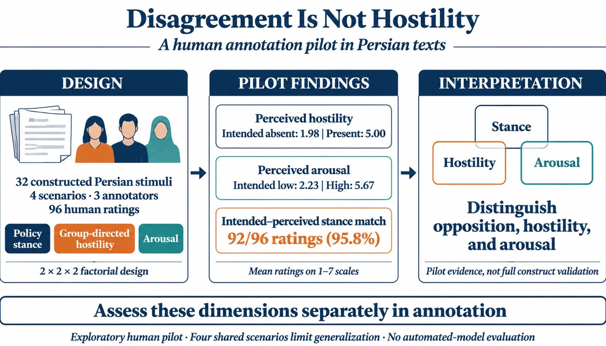
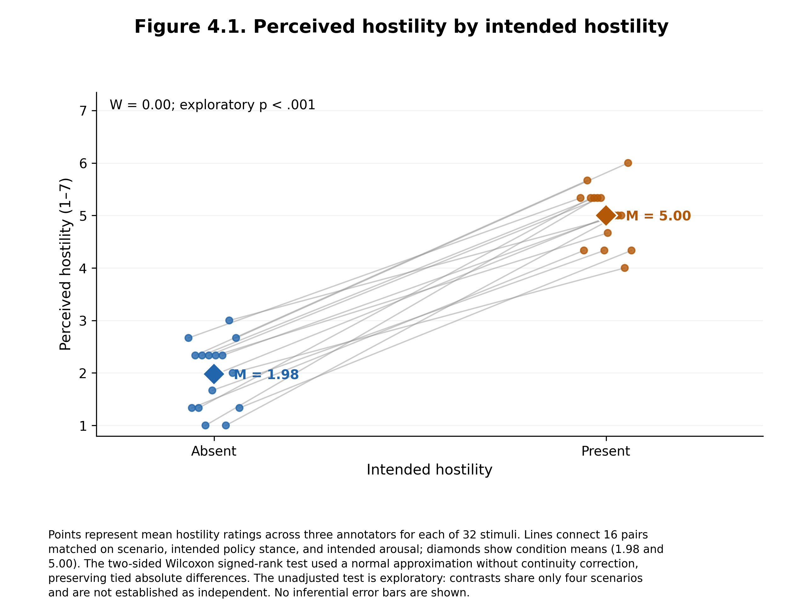
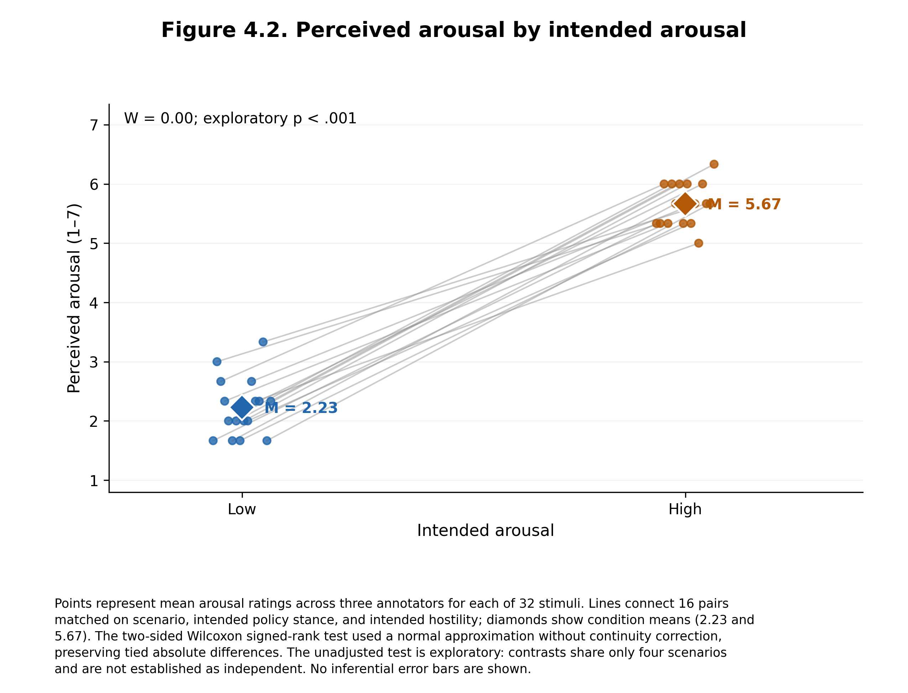
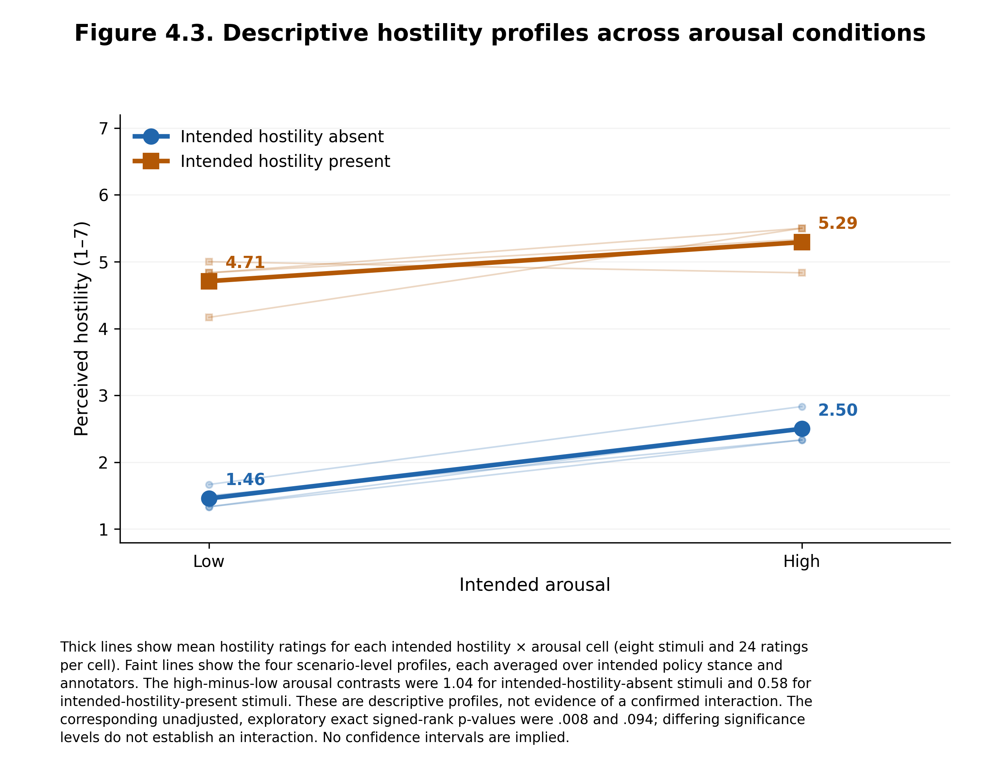
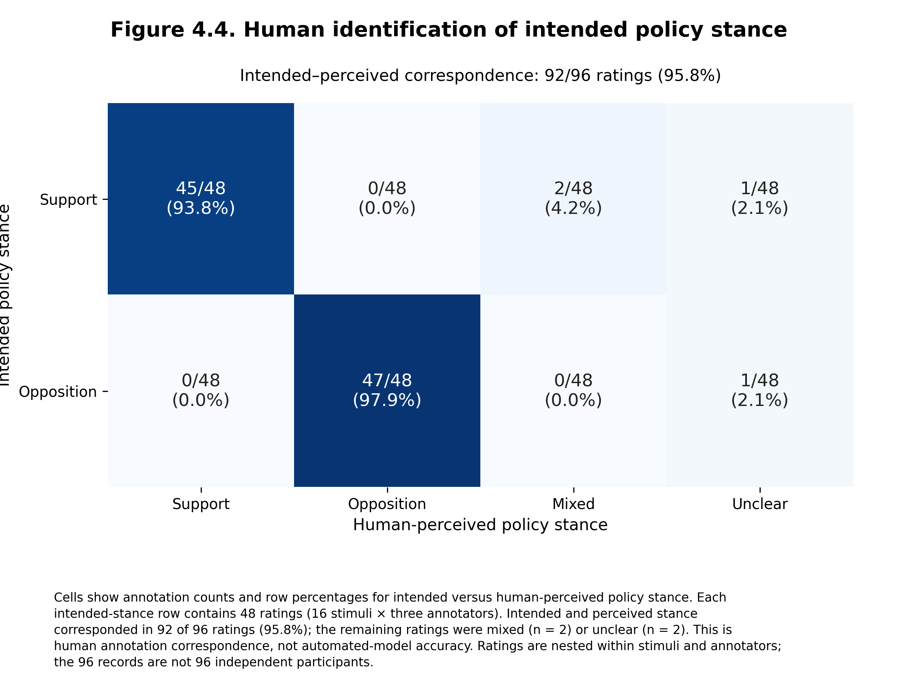
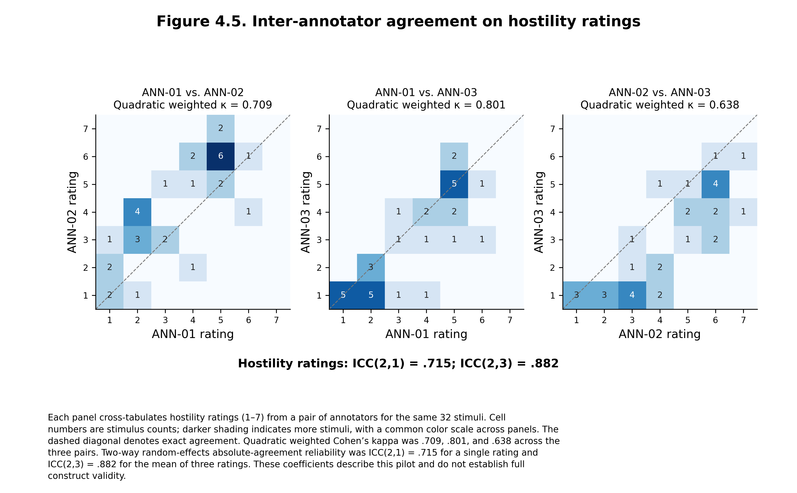

# Disagreement Is Not Hostility

**A Human Annotation Pilot on Policy Stance, Group-Directed Hostility, and Arousal in Persian Texts**  
Pegah Merrikhi

[](https://doi.org/10.5281/zenodo.24331046)

[Zenodo archive (v1.0.0)](https://doi.org/10.5281/zenodo.24331046) · [Results](#key-results) · [Figures](#results-figures) · [Reproduction](#reproduce-the-pilot) · [Citation](#citation)

This repository contains data, analysis code, and figures for a Persian-language human annotation pilot. Three annotators each rated 32 stimuli across four scenarios, yielding 96 records. The stimuli crossed intended policy stance (support/opposition), group-directed hostility (absent/present), and arousal (low/high). The pilot materials and guideline are labeled `pilot-0.3`; this is distinct from the Zenodo release version.

## Graphical abstract



## Key results

| Measure | Pilot result | Details |
| --- | --- | --- |
| Perceived hostility | Intended present: **5.00**; intended absent: **1.98** | Mean matched difference: +3.02 points |
| Perceived arousal | Intended high: **5.67**; intended low: **2.23** | Mean matched difference: +3.44 points |
| Arousal and perceived hostility | High minus low arousal: **+1.04** points when hostility was intended absent; **+0.58** when intended present | Exploratory exact signed-rank tests: *W* = 0.00, *p* = .008; *W* = 1.50, *p* = .094, respectively. No interaction test. |
| Policy stance identification | **92/96 (95.8%)** matched the intended stance | 47/48 opposition; 45/48 support |
| Hostility rating agreement | **ICC(2,1) = .715**; **ICC(2,3) = .882** | Single-rater and three-rater-mean absolute agreement, respectively |
| Group target selected | **35/47 (74.5%)** intended present; **8/47 (17.0%)** intended absent | Denominators exclude unavailable target classifications |
| Naturalness | Overall mean **5.51/7** | Matched differences were −0.06 for intended hostility and −0.15 for intended arousal; these estimates do not establish equivalence. |

See the [full results report](results/REPORT.md), [matched tests](results/matched_tests.csv), [pairwise agreement](results/pairwise_agreement.csv), and [stance classification counts](results/stance_confusion.csv).

**Scope and limitations.** These are exploratory results from four scenarios. Multiple matched contrasts share scenarios, so their independence should not be assumed. The results do not establish construct validity, validate the separate 320-stimulus candidate set, or report model performance.

## Results figures

<details open>
<summary><strong>Figure 4.1. Inter-annotator agreement for perceived hostility</strong></summary>



</details>

<details>
<summary><strong>Figure 4.2. Perceived hostility across intended hostility conditions</strong></summary>



</details>

<details>
<summary><strong>Figure 4.3. Perceived arousal across intended arousal conditions</strong></summary>



</details>

<details>
<summary><strong>Figure 4.4. Perceived hostility across arousal conditions</strong></summary>



</details>

<details>
<summary><strong>Figure 4.5. Correspondence between intended and perceived policy stance</strong></summary>



</details>

## Data and documentation

| Resource | Contents |
| --- | --- |
| [Pilot stimuli](data/stimuli.csv) | 32 Persian stimuli, scenario identifiers, and intended conditions; not a blinded annotation instrument |
| [Pilot annotations](data/annotations.csv) | 96 ratings from three pseudonymous annotators |
| [Data dictionary](docs/DATA_DICTIONARY.md) · [Data card](docs/DATA_CARD.md) | Fields, coding, coverage, and scope |
| [Provenance](docs/PROVENANCE.md) · [Statistical reporting](docs/STATISTICAL_REPORTING.md) | Data history and analytic decisions |
| [Analysis plan](docs/ANALYSIS_PLAN.md) · [Reproducibility notes](docs/REPRODUCIBILITY.md) | Analysis and environment documentation |
| [License file](LICENSE) · [Rights notes](RIGHTS.md) | Check the terms applicable to code, stimulus text, and annotation data before redistribution. Do not assume the software license applies to every asset. |

## Reproduce the pilot

From the repository root, install dependencies in a Python 3.11 environment. The original analysis scripts expect `data/pilot/`; if your checkout has only `data/annotations.csv` and `data/stimuli.csv`, copy those two files into `data/pilot/` before running the analysis. Keep the originals in place.

```bash
python -m pip install -r requirements.txt "matplotlib>=3.6" pillow
python scripts/validate.py
python scripts/analyze.py
python scripts/make_figures.py
```

The analysis writes tables to `results/`. The updated figure script writes PNG, PDF, SVG, and TIFF files and plotting data to `figures/generated/`. It does not regenerate the graphical abstract.

## Citation

Cite the Zenodo archive when using the data, scripts, or figures. The DOI below identifies the archived release, not a journal article.

**APA-style**

> Merrikhi, P. (2026). *Disagreement is not hostility: A human annotation pilot on policy stance, group-directed hostility, and arousal in Persian texts* (Version v1.0.0) [Computer software]. Zenodo. https://doi.org/10.5281/zenodo.24331046

**BibTeX**

```bibtex
@misc{merrikhi2026disagreement,
  author    = {Merrikhi, Pegah},
  title     = {Disagreement Is Not Hostility: A Human Annotation Pilot on Policy Stance, Group-Directed Hostility, and Arousal in Persian Texts},
  year      = {2026},
  version   = {v1.0.0},
  publisher = {Zenodo},
  doi       = {10.5281/zenodo.24331046},
  url       = {https://doi.org/10.5281/zenodo.24331046}
}
```
